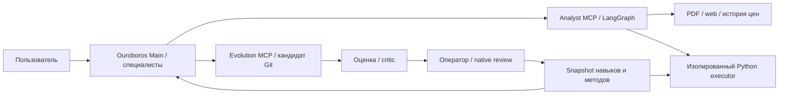

# OilAgent

[](https://github.com/HolyBayes/oilagent-core/actions/workflows/ci.yml) [](https://github.com/HolyBayes/oilagent/actions/workflows/assembly.yml)

Нефтегазовый аналитик на **Ouroboros и LangGraph**: ответы по отчётам OPEC/EIA и открытым источникам, прогноз Brent и контролируемое самоулучшение навыков.

Это сборочный репозиторий. Он фиксирует совместимые версии приложения и изменяемых методов в двух независимых Git submodules.

| Репозиторий | Назначение |
|---|---|
| [core](https://github.com/HolyBayes/oilagent-core) | Analyst/Evolution MCP, LangGraph, executor, Docker, тесты |
| [evolution](https://github.com/HolyBayes/oilagent-evolution) | Четыре самоулучшаемых скилла, шесть Python-методов, retrieval/source policies |

## Как устроено



## Запуск

Нужны Docker с Compose v2, Python 3.11+, доступ к LLM и интернет для первоначальной загрузки публичных PDF и embedding-модели.

```bash
git clone --recurse-submodules https://github.com/HolyBayes/oilagent.git
cd oilagent/core
cp .env.example .env
chmod 600 .env
```

Заполните `GIGACHAT_CREDENTIALS` в `.env`; при необходимости укажите CA bundle. По умолчанию используется GigaChat Lite (`GigaChat-2`). OpenAI-compatible и local профили описаны в core.

```bash
./run.sh -d
```

Откройте **http://127.0.0.1:8765**. В Skills выполните Review и включите `oilgas_analyst`, `oil_forecast`, `report_rag`, `web_research`. Review вызывает модель и расходует токены. При первом запуске скачиваются данные и веса; секреты и runtime не хранятся в Git.

Если submodules не загружены:

```bash
# Из корня oilagent:
git submodule update --init --recursive
```

## Попробовать

- «Что EIA в отчёте за октябрь 2025 прогнозировало для Brent в первом полугодии 2026?»
- «Какие свежие новости о природном газе опубликовало EIA за последние 7 дней?»
- «Сравни прогнозы роста спроса OPEC и EIA на 2026 год. Раздели источники».
- «Рассчитай новый прогноз Brent на 3 месяца с интервалами 80%».
- Проверка границ: «Напиши рецепт борща».
- «Для request_id … предложи улучшение query_strategy; покажи diff и проверки».

[Пять реальных диалогов](https://github.com/HolyBayes/oilagent-core/blob/main/examples/demo_dialogues.md) · [Архитектура](https://github.com/HolyBayes/oilagent-core/blob/main/ARCHITECTURE.md) · [Запуск и настройки](https://github.com/HolyBayes/oilagent-core#запуск) · [Проверки](https://github.com/HolyBayes/oilagent-core/blob/main/docs/VALIDATION.md)

## Самоулучшение

Из чата агент создаёт кандидатов изменений policy, инструкционных скиллов и существующих Python-методов. Core проверяет контракты и качество; Python исполняется отдельно от MCP и модельных секретов. Кандидат не меняет рабочую версию: нужны operator stage, native exact-package review и enable.

Новые произвольные MCP-инструменты и Python slots пока не создаются из чата — это TODO. Встроенный автоматический post-task evolution выключен.

Коммиты самоулучшений остаются в `evolution`. Для новой поставки оператор отдельно обновляет gitlink в этом репозитории. Обычный `git submodule update` возвращает зафиксированные версии: сначала сохраните локальные изменения. Репозитории независимы; commit внутри submodule не обновляет сборку автоматически.

## Проверено и ограничено

- Fixed acceptance: **30/30**, включая **13/13** retrieval-кейсов. Дополнительный известный набор — **12/19**. Это не blind benchmark и не точность всех ответов модели.
- Полный функциональный путь из fresh recursive clone: новые `.env` и данные, четыре первичных native review/toggle, пять новых UI-задач. Report/web/hybrid — `answered`, forecast — `forecasted`, внепрофильный — `out_of_scope`; период 1H26 проверен. [Свидетельства](https://github.com/HolyBayes/oilagent-core/blob/main/docs/from-zero-evidence.json). UI проверялся через штатный HTTP API; Docker build layers могли использовать кеш.
- Прогноз: Brent, ARIMA/ETS, 1–6 месяцев, номинальные 80% интервалы, backtest и naive benchmark. Интервалы не гарантируют покрытие при будущих шоках.
- Корпус: два frozen отчёта OPEC/EIA. Котировки Brent/WTI — delayed futures. OpenAI/local живьём не проверялись.
- Бюджеты задаются по запросам/подсистемам; общего гарантированного денежного лимита нет. Во время stage аналитические вызовы закрыты до завершения выпуска.

CI выполняет офлайн-проверки без LLM-ключей. Платные live-прогоны запускаются отдельно.
